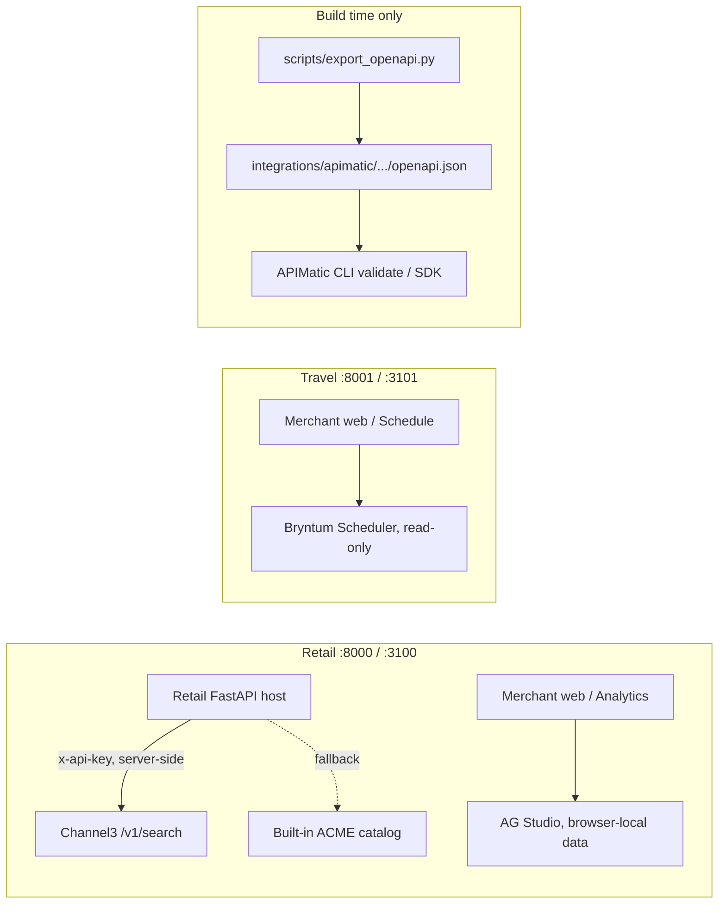

# PayPal Commerce AI Agent Operating System

**PayPal Commerce AI Agent Operating System**, shortened to **PayPal Commerce AI Agent OS**,
is a commerce operating system for agentic shopping
and merchant operations, combining a customer-facing **shopping agent**, a governed
**merchant agent**, PayPal checkout orchestration, shared safety controls, and reusable
vertical runtimes. Each agent is defined once—prompt, skills, tool contracts, and gates—and
runs through compatible Messages API, Agent SDK, and Managed Agent runtimes.

> [!NOTE]
> Every company, brand, product, and person here is fictional; the only company is ACME.
> The agent never handles a funding credential or captures money. `checkout` renders the cart
> for the host to complete, while `create_paypal_order` lets the agent prepare a real,
> cap-bounded PayPal Orders v2 order: the host reads its own prices, enforces the shopper's
> spend limit and its own ceiling, freezes an immutable cart snapshot, and creates the order
> with server-held credentials. The customer still approves on PayPal's page and the host
> captures it. Merchant writes pass provenance and guardrail checks and are **AI
> auto-approved** in the same turn; a human gate is opt-in. Business rules,
> authorization, fulfillment, and compliance are the deployment's.

For the case for this project (who benefits and why the payment step is the hard part), see
[Why this matters](../README.md#why-this-matters) in the repository README. Real screenshots of
the running retail demo are in [docs/screenshots/](docs/screenshots/) with their
[capture provenance](docs/screenshots/README.md), and can be regenerated with
`python scripts/capture_readme_screenshots.py`.

## Quick start: run the demos

Python 3.11+ and Node 22. From the repository root, install, add a key, and run a vertical:

```bash
python3 -m venv .venv && source .venv/bin/activate
pip install -r requirements.txt       # the seven packages and their pinned dependencies
cp .env.example .env                  # add OPENROUTER_API_KEY
(cd examples && npm ci)               # the eight web apps share one workspace
python scripts/run_demo.py retail     # API :8000 + storefront :3000
```

The demos use OpenRouter's `deepseek/deepseek-v4.1-flash` model by default. Set
`OPENROUTER_MODEL` to override it, and run
`python3 scripts/test_openrouter.py` to check connectivity and tool calling before starting
the UI.

The hackathon build also includes four optional sponsor integrations: Channel3 augments
retail discovery when `CHANNEL3_API_KEY` is set; AG Studio adds a self-service retail
analytics workspace; Bryntum adds a read-only travel occupancy and rate scheduler; and
APIMatic-ready OpenAPI contracts are generated with `python scripts/export_openapi.py`.
[Sponsor tools in the Agent OS](#sponsor-tools-in-the-agent-os) shows exactly where each one
runs, with links to the implementation; setup, boundaries, and verification are documented in
[`docs/sponsor-integrations.md`](docs/sponsor-integrations.md).

`--merchant` starts the portal instead of the storefront and `--all` starts both. The
verticals are `retail` (:3000, portal :3100), `travel` (:3001, :3101), `telecom` (:3002,
:3102), and `entertainment` (:3003, :3103); each README lists prompts to try on both surfaces.

Both web surfaces share one chat composer, so voice input works everywhere: press the
microphone, speak in English, and the browser's Web Speech API places the words in the text
field. Nothing is sent until you press Enter or **Send**. No API key or extra dependency is
required; Chrome, Edge and Safari are supported, and other browsers show a disabled
microphone with an explanation.

## Quick start: build your own

The included commerce-builder plugin scaffolds an agent on these packages against your
systems, or reviews one you have. Add this repository as a local plugin marketplace:

```bash
claude plugin marketplace add .
claude plugin install commerce-builder@paypal-commerce-agent-os
claude
/scaffold-commerce-agent a shopping assistant for our store
```

The command asks about your stack, plays the plan back, and builds the project; `/add-commerce-flow`
and `/author-commerce-evals` continue from there, and `/review-commerce-agent` starts from an agent
that already exists ([`plugins/commerce-builder/`](plugins/commerce-builder/)). Each command also
runs when a request matches its description, so naming it is optional.

## The two agents

The **shopping agent** searches, compares, plans, fills the cart, answers order and policy
questions, and remembers what a customer tells it. Its five flows are the skills in
[`shopping-agent/skills/`](shopping-agent/skills/); a deployment implements
[`StorefrontBackend`](shopping-agent/core/shopping_agent/backend.py) over its catalog,
cart, order, and policy systems.

The **merchant agent** explains performance, maintains listings, acts on inventory and order
alerts, prices and promotes, and drafts campaigns; every write is provenance- and
guardrail-checked, then **AI auto-approved** in the same turn. Set
`MERCHANT_REQUIRE_HOST_APPROVAL=1` to require a person's Approve click instead. Its five flows are the skills in [`merchant-agent/skills/`](merchant-agent/skills/);
a deployment implements [`MerchantBackend`](merchant-agent/core/merchant_agent/backend.py) over
its analytics, catalog, inventory, pricing, and campaign systems.

## Approval modes

**AI auto-approval is the demo default.** A compliant `stage_*` call runs provenance and
guardrail checks in `MerchantToolExecutor` and applies the change in the same turn; the tool
result and the activity trace carry an `AI auto-approved` audit line. A guardrail-held change
stays staged on its preview card. Set `MERCHANT_REQUIRE_HOST_APPROVAL=1` to restore the human
gate (`require_host_approval`), where the preview card's **Approve** button is the only way to
apply a change; the portal copy follows `NEXT_PUBLIC_MERCHANT_AUTO_APPROVE=0`. Both modes keep
provenance gates, guardrails, the change ledger and the two-step approval capability on the
host's apply/discard routes. See [`docs/safety.md`](docs/safety.md).

## Layout

| Directory | Contents | pip package, `import` name |
|---|---|---|
| [`commerce-common/`](commerce-common/) | What both roles share: config, fencing, memory, skills, grounding, presentation, executor frame, events, payments | `commerce-common`, `commerce_common` |
| [`shopping-agent/core/`](shopping-agent/core/) | Shopping types, `StorefrontBackend`, prompt, tool contracts, gates, executor | `shopping-agent-core`, `shopping_agent` |
| [`shopping-agent/runtime-messages-api/`](shopping-agent/runtime-messages-api/) | `ShoppingAgent`, the turn loop on the Messages API | `shopping-agent-runtime`, `shopping_agent_runtime` |
| [`shopping-agent/runtime-agent-sdk/`](shopping-agent/runtime-agent-sdk/) | The shopping agent on the Agent SDK, with a console | `shopping-agent-sdk`, `shopping_agent_sdk` |
| [`shopping-agent/managed-agents/`](shopping-agent/managed-agents/) | Manifest and storefront MCP server for Managed Agents | — |
| [`merchant-agent/core/`](merchant-agent/core/) | Merchant types, `MerchantBackend`, prompt, tool contracts, change guardrails, gates, executor | `merchant-agent-core`, `merchant_agent` |
| [`merchant-agent/runtime-messages-api/`](merchant-agent/runtime-messages-api/) | `MerchantAgent` and the analysis delegate on the Messages API | `merchant-agent-runtime`, `merchant_agent_runtime` |
| [`merchant-agent/runtime-agent-sdk/`](merchant-agent/runtime-agent-sdk/) | The merchant agent on the Agent SDK, with an approving console | `merchant-agent-sdk`, `merchant_agent_sdk` |
| [`merchant-agent/managed-agents/`](merchant-agent/managed-agents/) | Manifest, merchant MCP server, scheduled digest for Managed Agents | — |
| [`examples/`](examples/) | Four verticals, shared host code (`demo_common/`), shared web code (`web-shared/`) | — |
| [`plugins/commerce-builder/`](plugins/commerce-builder/) | The Claude Code plugin | — |
| [`docs/`](docs/) | Safety, backend mapping, deployment, commerce OS, and PayPal payment guides | — |
| [`tests/`](tests/) | Cross-package suites; each package also has its own `tests/` | — |
| [`scripts/`](scripts/) | `install.sh`, `run_demo.py`, `smoke_chat.py`, `screenshot_tour.py`, `check.py`, `deploy_managed_agent.sh`, `verify_all.py` | — |

## Three ways to run an agent

**Messages API.** The primary loop; the examples are host applications around it:

```python
from pathlib import Path

from shopping_agent import ShoppingAgentConfig
from shopping_agent_runtime import ShoppingAgent

agent = ShoppingAgent(backend=your_backend, skills_dir=Path("shopping-agent/skills"),
                      config=ShoppingAgentConfig(brand_name="Your Store"))
async for event in agent.stream_turn(messages, session, state):
    ...   # text_delta, tool_call, ui, cart_update (change_update on the merchant side), turn_complete
await agent.update_memory(messages, session)   # memory extraction; this path only
```

The example hosts take the session id in an `X-Session-Id` header.

**Agent SDK.** The same prompt, skills, and tools, with the SDK running the loop; the host
prefetches grounding reads, and nothing runs after the turn:

```bash
python shopping-agent/runtime-agent-sdk/main.py --once "a two-person tent under $250"
python merchant-agent/runtime-agent-sdk/main.py          # SDK console: y/N approval (separate runtime)
```

**Managed Agents.** A hosted agent over the same skills and contracts, calling your MCP server:

```bash
scripts/deploy_managed_agent.sh shopping-agent/managed-agents/shopping-agent   # or merchant-agent/...; --live deploys
```

## PayPal inside the agent loop

PayPal is a first-class tool, not a bolt-on. The built-in `create_paypal_order` tool is
registered in the tool registry, both agent runtimes, and the storefront MCP server. A shopper
who names the items and a maximum total gets a real sandbox order prepared within that cap:

- **Provenance.** Every `product_id` must have come from a catalog or order tool this session.
- **Three limits.** The tool clamps the model's cap, `CheckoutService` clamps it again to
  `COMMERCE_MAX_ORDER_AMOUNT`, and an over-cap cart is refused before any payment row exists.
- **Host-owned money.** The server re-reads its own cart for prices, quantities and currency;
  no payment credential, bearer checkout URL, or capture ever enters model context.
- **Visible receipt.** The cap, immutable snapshot hash and PayPal order id appear on the hosted
  checkout page and the in-chat checkout card. Nothing is charged until the customer approves.

`scripts/run_demo.py` enables sandbox checkout by default whenever credentials are present and
warns loudly when they are missing; `--no-paypal` is the explicit offline switch.
`scripts/demo_paypal_order.py` records a real `create → approve → capture → webhook → status`
run; its `--resume-order` mode finishes an order the agent already created whose hosted
checkout draft has expired. [`SANDBOX-PROOF.md`](SANDBOX-PROOF.md) is the honest record of
what has actually been recorded — currently one real sandbox order awaiting buyer approval,
with every later step still `NOT RECORDED`. See [`docs/payments.md`](docs/payments.md).

## Sponsor tools in the Agent OS

The [PayPal AI Hackathon](https://paypalaihackathon.devpost.com/resources) lists AG Grid,
APIMatic, Bryntum and Channel3 as optional "Select Sponsor Tools". All four are wired into this
repository as working integrations. They are **additive**: with no sponsor credentials the
storefronts, merchant tools, checkout and approval workflow keep running on the built-in ACME
data. Only the PayPal sandbox plus an AI model are required by the
[Official Rules](https://paypalaihackathon.devpost.com/rules); a sponsor tool instead makes a
submission eligible for the separate "Best Use of …" prizes.



| Tool | Runs in | Surface | Credential |
|---|---|---|---|
| **Channel3** | Python host (server-side) | Retail storefront search; `ch3:` products | `CHANNEL3_API_KEY` — the only real API key |
| **AG Grid / AG Studio** | Browser (merchant web) | Retail **Analytics studio**, `:3100` | Optional `NEXT_PUBLIC_AG_STUDIO_LICENSE_KEY` |
| **Bryntum Scheduler** | Browser (merchant web) | Travel **Revenue schedule**, `:3101` | None — keyless npm trial alias |
| **APIMatic** | Build / CI only | Generated OpenAPI contracts and SDKs | None — CLI login is optional |

### Channel3 — live product discovery

[`examples/retail/api/channel3_catalog.py`](examples/retail/api/channel3_catalog.py) adapts
Channel3 to the `StorefrontBackend` catalog contract;
[`examples/retail/api/mock_retail.py`](examples/retail/api/mock_retail.py) calls it on every
shopper search:

```python
# examples/retail/api/channel3_catalog.py
headers = {
    "x-api-key": self.api_key,
    "x-user-id": self._partner_user(session),   # SHA-256 of the session user id
    "Accept": "application/json",
}
```

- `Channel3Catalog.from_env()` returns `None` when `CHANNEL3_API_KEY` is empty, so the adapter
  is inert by default. It calls `/v1/search` and `/v1/products/{id}` on `CHANNEL3_BASE_URL`
  (default `https://api.trychannel3.com`) with a bounded timeout and result count.
- Results are normalized into the same `ProductDetails` contract, namespaced with `ch3:` so
  they cannot collide with local SKUs, and cached for detail lookups. The key never reaches
  the browser or the model.
- Any failure, timeout or malformed response falls back to the local catalog; `GET /api/health`
  reports `integrations.channel3.enabled` and `cached_products`. Merchant tools deliberately
  stay on the authoritative local catalog. A production deployment must re-fetch the
  authoritative offer and revalidate price, availability, seller, tax and fulfillment before
  creating a PayPal order.
- Hackathon keys include 20,000 free credits with promo code `PAYPAL-HACKATHON-2026` at
  [trychannel3.com/developers](https://trychannel3.com/developers). The sponsor rules require
  an actual API call — a project that only references Channel3 does not qualify.

### AG Grid / AG Studio — merchant analytics

[`AnalyticsView.tsx`](examples/retail/merchant-web/components/views/AnalyticsView.tsx) builds
six governed, browser-local data sources from merchant API responses — performance trends,
catalog, inventory alerts, order issues, recent orders and change history — and hands them to
AG Studio in
[`AgStudioWorkspace.tsx`](examples/retail/merchant-web/components/analytics/AgStudioWorkspace.tsx):

```tsx
const studio = <AgStudio data={{ sources }} mode="edit" />;
const licenseKey = process.env.NEXT_PUBLIC_AG_STUDIO_LICENSE_KEY;
return licenseKey ? <AgStudioProvider licenseKey={licenseKey}>{studio}</AgStudioProvider> : studio;
```

The dependency is `ag-studio-react` ^3.1.0, AG Grid's embedded analytics product; the
`ag-grid-*` packages in the lockfile are transitive. Operators build grids, KPI tiles, charts,
filters and cross-filtered reports without changing the agent backend. Only merchant API
responses enter the dashboard — no server key or payment credential. A free 45-day AG Studio
trial licence is optional; without one Studio runs in trial mode.

### Bryntum — travel revenue schedule

[`ScheduleView.tsx`](examples/travel/merchant-web/components/views/ScheduleView.tsx) feeds
`fetchOccupancy()` into
[`BryntumOccupancyScheduler.tsx`](examples/travel/merchant-web/components/schedule/BryntumOccupancyScheduler.tsx),
which renders properties as resources and weekly occupancy/rate windows as events.
Agent-staged overrides are orange, and the scheduler is `readOnly` by design: pricing changes
still go through the merchant agent's stage → guardrail check → AI auto-apply sequence.

```json
"@bryntum/scheduler": "npm:@bryntum/scheduler-trial@^7.3.8"
```

That public npm **trial alias** needs no licence key for the 45-day hackathon trial.
`BRYNTUM_LICENSE_KEY` and `NEXT_PUBLIC_BRYNTUM_LICENSE_KEY` in `.env.example` are reserved
placeholders — no source file reads them. Replace the alias with the licensed package source
before a production distribution.

### APIMatic — API contracts, SDKs and docs

[`scripts/export_openapi.py`](scripts/export_openapi.py) loads each real FastAPI app and writes
its OpenAPI schema into APIMatic's `src/spec` layout at
`integrations/apimatic/<vertical>/src/spec/openapi.json`. The contracts cover the storefront
and merchant routes, including PayPal create, capture, status and webhook endpoints.

```bash
python scripts/export_openapi.py
npx -y @apimatic/cli@2.1.0 api validate --file integrations/apimatic/retail/src/spec/openapi.json
npx -y @apimatic/cli@2.1.0 sdk generate --input integrations/apimatic/retail \
  --language typescript --destination build/apimatic/retail-typescript --force
```

Generated clients are consumers only: all authorization, pricing, provenance, PayPal capture
and merchant approval checks stay server-side. There is **no runtime API key**;
`apimatic auth login` is a developer-tool account for generating your own SDK or portal. See
[`integrations/apimatic/README.md`](integrations/apimatic/README.md).

### Credentials and where to put them

| Variable | File | Needed? |
|---|---|---|
| `CHANNEL3_API_KEY`, `CHANNEL3_BASE_URL`, `CHANNEL3_MAX_RESULTS`, `CHANNEL3_TIMEOUT_SECONDS` | `.env` at the repo root | **Yes**, to actually call Channel3 |
| `NEXT_PUBLIC_AG_STUDIO_LICENSE_KEY` | `examples/retail/merchant-web/.env.local` or exported in the shell | Optional trial / licence key |
| `BRYNTUM_LICENSE_KEY`, `NEXT_PUBLIC_BRYNTUM_LICENSE_KEY` | `.env` | No — unused placeholders |
| — (APIMatic) | — | No |

Copy [`.env.example`](.env.example) to `.env`; both `.env` and `.env.local` are gitignored. The
Python host loads process env → `examples/<vertical>/.env` → repo-root `.env` with
`override=False`. `scripts/run_demo.py` forwards only `NEXT_PUBLIC_COMMERCE_PLATFORM` from the
root `.env` into Next.js, so the AG Studio key must be exported in the shell or placed in the
merchant web app's `.env.local`. Per the Official Rules' Testing section, judges need any test
credentials or sandbox logins documented in the submission's testing instructions — never
commit real keys.

### Verify the integrations

```bash
pytest examples/retail/api/tests/test_channel3_catalog.py -q   # adapter, mapping, fallback
python scripts/export_openapi.py --vertical retail               # APIMatic contract
python scripts/run_demo.py retail --merchant                    # :3100 → Analytics studio
python scripts/run_demo.py travel --merchant                    # :3101 → Revenue schedule
```

Full boundaries, failure handling and production notes are in
[`docs/sponsor-integrations.md`](docs/sponsor-integrations.md).

## Safety

Fencing, provenance gates, caps, memory validation, and the merchant guardrails run
inside the tool call and hold on all three paths; AI auto-approval is the demo default and a
human gate is opt-in; grounding, the analysis budgets, and memory
extraction are runtime features. [`docs/safety.md`](docs/safety.md) lists each rule with its
module and paths, and what a deployment adds first. The examples have no operator login, but
the preview card apply/discard routes still require a short-lived, single-use,
session-bound approval capability (and optionally an injected operator token); the MCP
servers bind to loopback.

## PayPal Commerce AI Agent OS

[`docs/commerce-os.md`](docs/commerce-os.md) describes the control plane, production service
boundaries, and build-out sequence. [`docs/payments.md`](docs/payments.md) documents the
PayPal checkout that is on by default: OAuth, Orders v2 create/capture, opaque checkout tokens,
SQLite/Postgres payment state, webhook verification, the cap-bounded auto-buy tool, and the
requirements that remain before a live launch. [`SANDBOX-PROOF.md`](SANDBOX-PROOF.md) records
the real sandbox evidence gathered so far, including the pending order still awaiting buyer
approval.

## Verticals

| Example | Storefront | Portal |
|---|---|---|
| [`examples/retail/`](examples/retail/) ACME | Search, comparison, plans, cart, checkout, memory over the built-in components | Digest, staged restocks and listing fixes, analysis delegate over a SQL view |
| [`examples/travel/`](examples/travel/) ACME Travel | Date-bound inventory and a `present_itinerary` extension | Occupancy calendar and date-window rate moves |
| [`examples/telecom/`](examples/telecom/) ACME Mobile | Account context, plan matrix, server-authored fee disclosures | Plan mix, price moves that state the lines affected, protected regulated fees |
| [`examples/entertainment/`](examples/entertainment/) ACME Tickets | Timed holds, waitlists, transfers, venue map, all-in fee disclosures | Event pacing, hold releases that add real capacity, fee-preserving price moves |

Each example's README has a `Try` section: the turns `scripts/smoke_chat.py` runs, and single
prompts with what a good answer does.

## Verify

```bash
ruff check . && ruff format --check . && pytest && python scripts/check.py
python scripts/verify_all.py                        # the line above plus deploy dry runs and web builds
python scripts/smoke_chat.py --vertical travel      # one live conversation; needs a key
```

`requirements-dev.txt` adds pytest and ruff. CI installs from it on two Python versions,
builds the eight web apps, and checks that the package names stay unregistered on the
public index (the pin files install them from their directories, never from the index). To confirm caching, read
`cache_read_input_tokens` from `turn_complete`, or the line each model call logs on its
runtime's logger: zero on a second turn means the prefix changed.

## Deploying elsewhere

The runtimes take an injected Messages-compatible client as `client=`, and the SDK runtimes
take the platform from the CLI environment. [`docs/deployment.md`](docs/deployment.md) covers
OpenRouter, GCP Vertex AI, AWS Bedrock, Microsoft Foundry, and compatible gateways.

## MCP connectors

The retail shopping agent now includes a [WooCommerce adapter and WordPress bridge](docs/woocommerce.md)
with native checkout and paid-order synchronization. Set `COMMERCE_PLATFORM=woocommerce` to
use it. To connect your store, install the [plugin](integrations/woocommerce/agent-commerce-bridge.php)
and configure `WOOCOMMERCE_URL` and `WOOCOMMERCE_BRIDGE_SECRET` using the updated
[`.env.example`](.env.example).

A [Shopify adapter and multi-merchant administration service](docs/merchant-platform.md)
provide native checkout, signed paid-order receipts, encrypted tenant configuration,
durable shopper sessions, and owner-approved operations. See the guide for setup, tests,
and remaining deployment/integration boundaries.

No third-party MCP connectors ship; both agents
reach other systems through the backend interfaces. Where an official
connector is the source of record, it is the integration target: analytics warehouses (Snowflake,
BigQuery, Databricks, Amplitude), finance (Stripe, Square, PayPal, QuickBooks), delivery (Slack, Google Drive, Gmail).
A commerce platform's own MCP server for catalog, cart, or checkout is called from a backend
method server-side; on Managed Agents the manifest mounts it beside the role's server, and the
provenance gates stay in front of every write.

## Making it yours

- **Backend methods.** Each one calls your service server-side with the
  credential your host holds for the session; the model reads only the result. A flow whose
  steps have a fixed order enforces that order in the backend.
- **Read the backend guide.** [`docs/backends.md`](docs/backends.md) walks through
  identity and credentials, ordered flows, checkout, products with options, and figures
  your platform cannot supply.
- **The same interface covers other business shapes.** On a marketplace, seller is a search
  dimension and the merchant agent acts for the operator the session names. With account or
  contract pricing, the price quoted is the session account's. With no checkout of your
  own, turn the cart off or hand it to a quote, a purchase order, or a hosted checkout URL.
- **Checkout hands off.** The checkout card links to your own checkout route, or to the
  platform's hosted checkout URL (one per seller on a marketplace). The backend returns the
  URL and the host renders it; the model never sees it.
- **Start small.** A shopping pilot implements search and product details and stubs the
  rest; a stubbed method returns an unavailable result and changes no prompt bytes. A
  merchant pilot implements the eight read methods and has the writes refuse; digests and
  metrics then run with no write path.
- **Switch off what you do not have.** A system the business lacks entirely (no cart on a
  referral surface, no order tracking) is an `enable_*` switch turned off, which removes its
  tools, prompt lines, and grounding rule on every path; park the flows that need it under
  `skills/_staged/`. The merchant config has the same switches for listing edits, inventory,
  pricing, and campaigns.
- **Add your own.** A flow is a directory with a `SKILL.md` under either `skills/`. Domain
  UI is a `PresentationExtension` (the verticals ship seven). `brand_name`,
  `assistant_name`, and `brand_voice` on either config set the identity.

## License

Licensed under the [Apache License 2.0](LICENSE). Third-party notices are in
[NOTICE](../NOTICE), attribution in [CREDITS.md](../CREDITS.md), and the work added
for this project in [CHANGES.md](../CHANGES.md).

Independent submission to the PayPal AI Hackathon, built with the PayPal sandbox APIs.
PayPal, Inc. is the hackathon sponsor.

