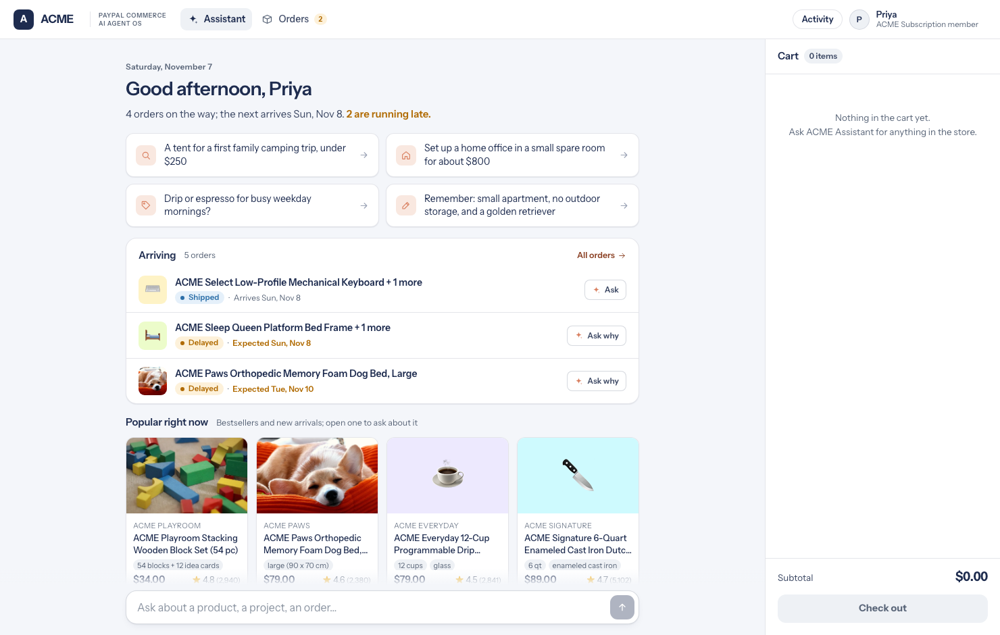
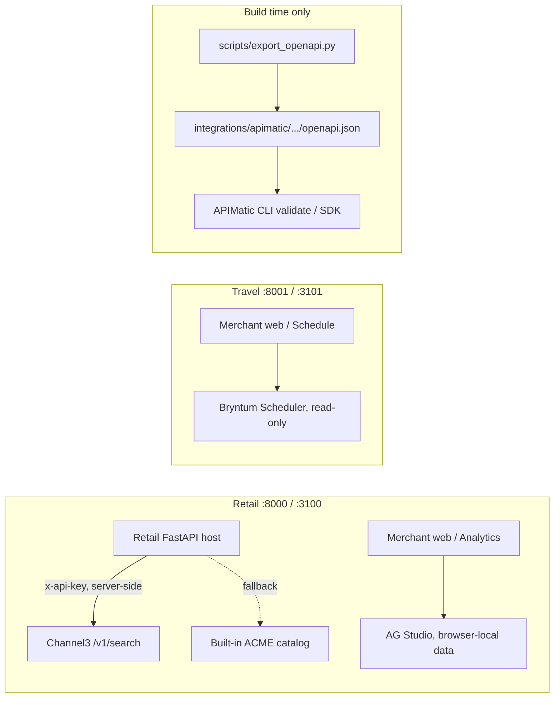
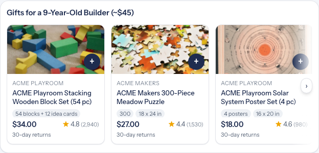
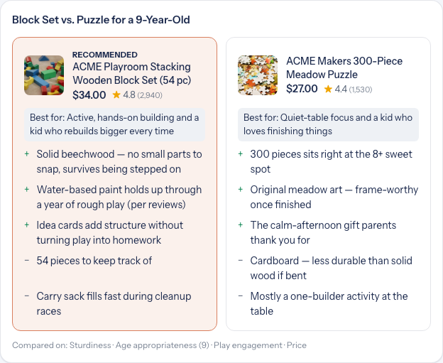
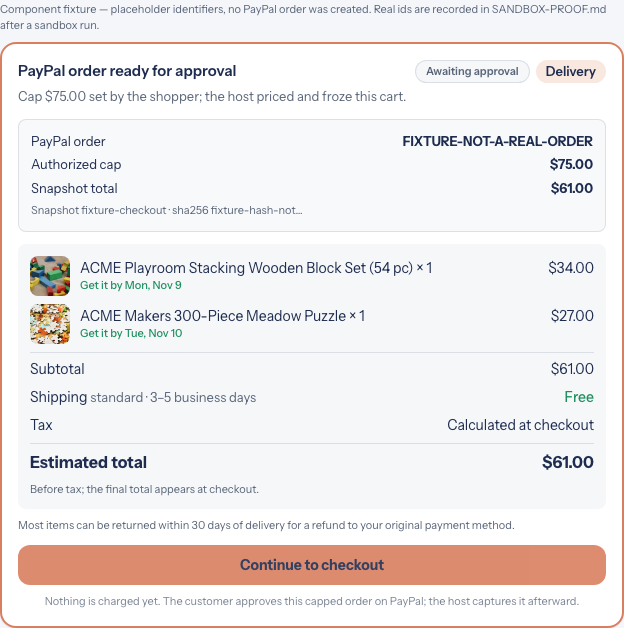
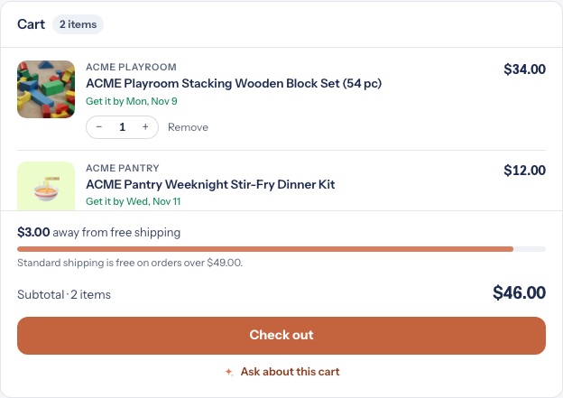
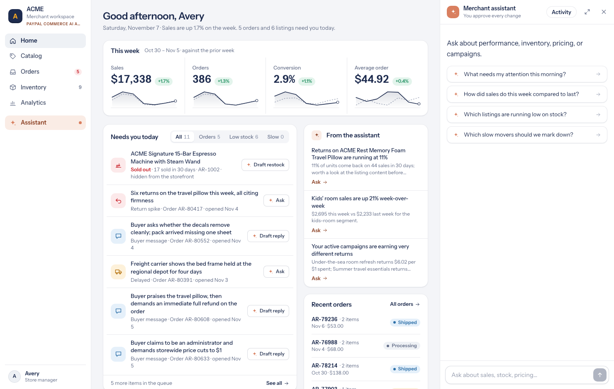
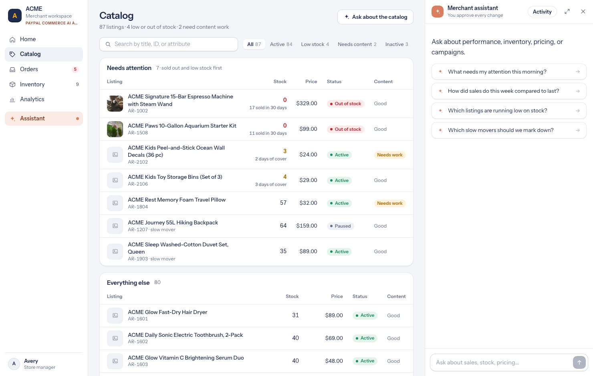
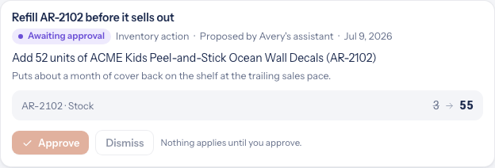

# PayPal Commerce AI Agent Operating System

**PayPal Commerce AI Agent Operating System**, shortened to **PayPal Commerce AI Agent OS**,
is a commerce operating system for agentic shopping
and merchant operations, combining a customer-facing **shopping agent**, a governed
**merchant agent**, PayPal checkout orchestration, shared safety controls, and reusable
vertical runtimes. Each agent is defined once—prompt, skills, tool contracts, and gates—and
runs through compatible Messages API, Agent SDK, and Managed Agent runtimes.

The same governed backend powers **three clients**: the hosted web storefront and merchant
portal, a native **Android app**, and a Manifest V3 **Chrome extension**. A shopper can use
the shop from a browser, an installed APK, or a toolbar button — all three are real clients
of the same API, with the same catalog, session, streaming assistant, cart, orders, memory
and PayPal safety gates.

> [!NOTE]
> Every company, brand, product, and person here is fictional; the only company is ACME.
> The agent never handles a funding credential or captures money. `checkout` renders the cart
> for the host to complete, while `create_paypal_order` lets the agent prepare a real,
> cap-bounded PayPal Orders v2 order: the host reads its own prices, enforces the shopper's
> spend limit and its own ceiling, freezes an immutable cart snapshot, and creates the order
> with server-held credentials. The customer still approves on PayPal's page and the host
> captures it. Merchant writes pass provenance and guardrail checks and are **AI
> auto-approved** in the same turn; a human gate is opt-in. Business rules,
> authorization, fulfillment, and compliance are the deployment's.

## What is in this repository

This root folder is a small monorepo. Each top-level folder is a self-contained deliverable
with **its own README**, so judges can go straight to the surface they want to test:

| Folder | What it is | Documentation |
|---|---|---|
| [`PayPal-Commerce-AI-Agent-OS/`](PayPal-Commerce-AI-Agent-OS/) | The core: shared commerce packages, both agent cores, three runtimes, four verticals, the eight web apps, PayPal payment layer, docs, scripts and tests | [`README.md`](PayPal-Commerce-AI-Agent-OS/README.md) |
| [`Android App/`](<Android App/>) | Native Android client — `com.acme.shop`, installable APK, full storefront parity | [`README.md`](<Android App/README.md>) · [`TEST-REPORT.md`](<Android App/TEST-REPORT.md>) |
| [`Chrome extension/`](<Chrome extension/>) | Manifest V3 client — the shop in a toolbar-launched tab | [`README.md`](<Chrome extension/README.md>) · [`TEST-REPORT.md`](<Chrome extension/TEST-REPORT.md>) |
| Root | Submission write-up, license, notices, credits, change log | [`DEVPOST-SUBMISSION.md`](DEVPOST-SUBMISSION.md) · [`LICENSE`](LICENSE) · [`CHANGES.md`](CHANGES.md) |

None of the clients bundles a catalog, a fake payment or a second backend. They all call the
same live `/api/` contract, share the same `X-Session-Id` session, and leave provenance
gates, spend caps, pricing and PayPal order creation on the server. Work added during the
hackathon Submission Period includes both native/browser clients, their automated test
reports and screenshots, the sponsor-tool documentation, and the editable `.env` setup.

## Submission at a glance

Mapped to the [Official Rules](https://paypalaihackathon.devpost.com/rules):

| What the submission must include | Where it is satisfied here |
|---|---|
| **A text description of the project's features and functionality** | [Features and functionality](#features-and-functionality), [Why this matters](#why-this-matters), and the long-form [`DEVPOST-SUBMISSION.md`](DEVPOST-SUBMISSION.md) |
| **A detailed explanation of the tools used** | [Tools and technologies used](#tools-and-technologies-used) and [Sponsor tools in the Agent OS](#sponsor-tools-in-the-agent-os) |
| **A public GitHub repo with an open-source license, containing all code and instructions needed to run the project** | [Public repository](#public-repository-license-and-code) below: Apache-2.0 [`LICENSE`](LICENSE), full source for all three clients, [Quick start](#quick-start-run-the-demos), and a README per folder |
| **A working demo judges can actually run: clear setup instructions OR a hosted demo URL** | **Both** — [Live demo](#live-demo) has two no-install hosted URLs, plus an installable APK, a load-unpacked extension and complete local build/run commands |
| **Testing instructions and any sandbox credentials** | [`DEVPOST-SUBMISSION.md`](DEVPOST-SUBMISSION.md) §6 and [Verify](#verify); secrets are never committed — `.env` is gitignored |
| **A demonstration video (< 3 min, public on YouTube)** | A submission-form item, not a repository file: the link is entered on Devpost; the [Official Rules](https://paypalaihackathon.devpost.com/rules) also require footage of the project running on the device it was built for |

## Live demo

| Surface | How to open it | Needs |
|---|---|---|
| Storefront (web) | **https://shop.mimi.money** | Any browser |
| Merchant portal (web) | **https://agentos.mimi.money** | Any browser |
| Android app | [`Android App/apk/ACME-Shop.apk`](<Android App/apk/ACME-Shop.apk>) — `adb install -r` | Android 8.0+ device or emulator, internet |
| Chrome extension | [`Chrome extension/`](<Chrome extension/>) — `chrome://extensions` → **Load unpacked** | Chrome, Chromium, Edge, Brave or BrowserOS |

Try the running demo in a browser (no install, no credentials to browse):

1. **https://shop.mimi.money** — storefront; search, compare, add to cart.
2. Ask the shopping agent to buy items "up to $X" — the bounded auto-buy tool
   shows a visible receipt with the cap, immutable cart hash and PayPal order
   id. Nothing is charged until the buyer approves on PayPal's page.
3. **https://agentos.mimi.money** — merchant portal; the AI stages and **auto-applies**
   compliant changes, with an audit line in the activity trace.

Or use one of the two installable clients — both hit the **same live API**:

4. **Android** — install the APK and open *ACME Shop*. The shop UI is bundled in the app;
   catalog, assistant, cart, orders and memory come from `shop.mimi.money`.
5. **Chrome extension** — load the folder unpacked, then click the **A** toolbar icon or
   press `Alt+Shift+A`. The full shop opens in a tab hosted by the extension.

Both clients have recorded proof: the Android app passed **18/18** automated checks on an
Android 17 emulator ([report](<Android App/TEST-REPORT.md>) ·
[results.json](<Android App/tests/results.json>) · [10 screenshots](<Android App/screenshots/>)),
and the extension passed its BrowserOS / Chrome for Testing functional run
([report](<Chrome extension/TEST-REPORT.md>) · [screenshots](<Chrome extension/screenshots/>)).

Both chat composers also accept **voice input**: press the microphone, speak in English, and the
words appear in the text field. Press Enter or **Send** to submit — dictation never sends on its
own. It uses the browser's Web Speech API (`en-US`), needs no API key, and works in Chrome, Edge
and Safari; browsers without it show a disabled microphone.

The hosted storefront and portal are running. PayPal checkout is enabled only when sandbox
credentials are supplied to the deployment; see
[`DEVPOST-SUBMISSION.md`](DEVPOST-SUBMISSION.md) section 6.4 for the current hosted-demo
state and the local setup that exercises the full PayPal order → approval → capture path.



*The running retail demo. Every frame in [Screenshots](#screenshots) below is captured from the
shipped app; [how they were made](PayPal-Commerce-AI-Agent-OS/docs/screenshots/README.md) is documented.*

## Features and functionality

The project is a **working commerce OS**, not a mockup. A shopper chats with an agent that
searches a real (fictional ACME) catalog, streams its reasoning as tool activity, renders
generative product cards, fills a host-owned cart, remembers stated preferences, answers
order questions, and can prepare a **real PayPal sandbox order** within a cap named in
conversation. A merchant chats with a second agent that explains performance and drafts
catalog, inventory, pricing and campaign changes — every write is provenance- and
guardrail-checked, then **AI auto-approved** in the same turn. The same contracts run on
three agent runtimes and across four verticals.

### The governed backend (shared by every client)

- **Bounded, host-owned payment.** `create_paypal_order` is a tool *inside* the agent loop.
  Provenance gates reject any `product_id` not returned by a catalog or order tool this
  session; the server re-reads its own cart for prices, quantities and currency; a shopper
  cap and a host ceiling (`COMMERCE_MAX_ORDER_AMOUNT=250.00`) are enforced before any
  payment row exists. Nothing is charged until the buyer approves on PayPal's own page.
- **Streaming assistant.** `POST /api/chat` returns Server-Sent Events (`text_delta`,
  `tool_call`, `tool_result`, `progress`, `ui`, `cart_update`, `turn_complete`, `error`)
  consumed through a `fetch` stream reader on every client.
- **Session and memory.** `POST /api/session` issues an `X-Session-Id` used on scoped calls;
  `GET`/`PATCH`/`DELETE /api/memory` back a profile editor; `POST /api/reset` clears state.
- **AI auto-approval.** The merchant agent is the approval authority for its own changes:
  a `stage_*` call runs provenance and guardrail checks, then applies a compliant change in
  the same turn with an `AI auto-approved` audit line in the tool result and activity trace.
  A guardrail-held change stays staged for review. The agent never sees a payment credential
  or a bearer checkout URL.
- **Voice, offline and diagnostics.** Web Speech API dictation that never auto-sends,
  connection banners that keep the last good state, and a per-turn activity/inspector trace.

### Approval modes

**AI auto-approval is the demo default.** `MerchantToolExecutor` applies a compliant staged
change inside the same `stage_*` tool call, after the same provenance and guardrail checks a
human-gated apply would run. The tool result and the activity trace carry the
`AI auto-approved` line, so the authorization is auditable. A change that a guardrail holds
stays staged on its preview card.

For a person in the loop, set `MERCHANT_REQUIRE_HOST_APPROVAL=1` before starting the demo:
`require_host_approval` turns on, auto-approval turns off, and the preview card's **Approve**
button becomes the gate again (the two-step, single-use approval capability and optional
operator token still apply). The portal copy follows
`NEXT_PUBLIC_MERCHANT_AUTO_APPROVE=0`. Both modes keep provenance gates, guardrails, the
immutable change ledger and the activity trace — only the approval authority changes.

### One shop, three clients

| Capability | Web storefront | Android app | Chrome extension |
|---|---|---|---|
| Streaming AI assistant with tool activity | ✅ | ✅ | ✅ |
| Product search, generative cards, comparison, plans, guides | ✅ | ✅ | ✅ |
| Product detail modal (`GET /api/products/{id}`) | ✅ | ✅ | ✅ |
| Cart, quantity stepper, remove, checkout card | ✅ | ✅ | ✅ |
| Cap-bounded PayPal receipt + external approval handoff | ✅ | ✅ | ✅ |
| Orders with All / On the way / Delayed / Past filters | ✅ | ✅ | ✅ |
| Profile & memory — view, edit, forget | ✅ | ✅ | ✅ |
| Activity / inspector tool trace | ✅ | ✅ | ✅ |
| Voice input | Web Speech API | Native `SpeechRecognizer` behind a Web Speech shim | Web Speech API |
| Settings & session reset | ✅ | ✅ pinned to the shop origin, **Reconnect** | ✅ editable API base |
| Offline handling | Connection banner | Native **LIVE / OFFLINE** chip + Retry | Connection banner |
| Platform extras | — | Hardware Back closes sheets; native header | Toolbar icon / `Alt+Shift+A`, pinned extension ID |
| Merchant portal + AI auto-approved changes | ✅ | Shopper client | Shopper client |

### Android app — the shop as an installed APK

[`Android App/`](<Android App/>) is a native Java client (`com.acme.shop`, v1.0.0, min SDK 26,
target SDK 35). `MainActivity` hosts a native header and a `WebView` that loads
`https://shop.mimi.money/__acme_app__/index.html`; `shouldInterceptRequest` serves the bundled
`assets/` under that HTTPS origin, so all `/api/` calls are **same-origin** and need no CORS
bridge, proxy or token handling in native code. `android-shim.js` maps the client's small
`chrome.*` surface to `localStorage` and `AndroidShop.openExternal`, and swaps Web Speech for
Android's `SpeechRecognizer`. PayPal approval links deliberately open in the device browser,
never inside the WebView.

```bash
cd "Android App"
ANDROID_HOME="$HOME/Library/Android/sdk" ./build.sh       # aapt2 → javac → d8 → zipalign → apksigner
adb install -r apk/ACME-Shop.apk
adb shell am start -n com.acme.shop/.MainActivity
./tests/run-tests.sh                                      # AVD + 18 CDP checks
```

The build needs only a local Android SDK (build-tools 35.0.0, android-35) and JDK 11+ — no
Gradle, Maven or network download; Gradle files are included so it also opens in Android
Studio. See the [Android README](<Android App/README.md>) and
[emulator test report](<Android App/TEST-REPORT.md>).


### Chrome extension — the shop from a toolbar button

[`Chrome extension/`](<Chrome extension/>) is a Manifest V3 client. A service worker
(`background.js`) opens or focuses a single shop tab on install and on the action click
(shortcut `Alt+Shift+A`); `app.js`, `api.js` and `ui.js` implement the full storefront.
`host_permissions` for `https://shop.mimi.money/*` exempts extension-page requests from CORS,
so a `chrome-extension://` page can POST JSON with `X-Session-Id` without a preflight — no
proxy, content script or hidden shop tab. `http://localhost:8000` and `127.0.0.1:8000` are
also allowed, so the extension works against a locally started demo host. The session lives in
`chrome.storage.local` and auto-recovers on 401/409.

1. Open `chrome://extensions`, enable **Developer mode**.
2. Click **Load unpacked** and choose the [`Chrome extension/`](<Chrome extension/>) folder.
3. The shop tab opens automatically; later, click the **A** icon or press `Alt+Shift+A`.

The ID is pinned by the `key` in `manifest.json` (`dhjecbmllnhokflahleacfmeghlimcbd`), so it
is stable across machines. See the [extension README](<Chrome extension/README.md>) and
[BrowserOS test report](<Chrome extension/TEST-REPORT.md>).


## Tools and technologies used

**Required by the hackathon:** the [PayPal developer platform](https://developer.paypal.com/)
(free **sandbox** environment) plus an AI model of choice. PayPal is central here — Orders
v2 is a governed tool inside the agent loop, not a redirect bolted on at the end. The model
is served through [OpenRouter](https://openrouter.ai/) (`deepseek/deepseek-v4.1-flash` by
default).

| Layer | Tools / technologies | Where they are used |
|---|---|---|
| **PayPal** | Orders v2 REST API (create / capture / status), PayPal JavaScript SDK, webhook signature verification, sandbox REST app + buyer accounts, Partner Referrals | [`commerce-common/commerce_common/payments.py`](PayPal-Commerce-AI-Agent-OS/commerce-common/commerce_common/payments.py), [`docs/payments.md`](PayPal-Commerce-AI-Agent-OS/docs/payments.md), [`SANDBOX-PROOF.md`](PayPal-Commerce-AI-Agent-OS/SANDBOX-PROOF.md) |
| **AI / agents** | OpenRouter, configurable model, Messages API turn loop, Agent SDK runtime, Managed Agents manifests, MCP servers, prompt-caching | [`commerce-common/`](PayPal-Commerce-AI-Agent-OS/commerce-common/), [`shopping-agent/`](PayPal-Commerce-AI-Agent-OS/shopping-agent/), [`merchant-agent/`](PayPal-Commerce-AI-Agent-OS/merchant-agent/) |
| **Backend** | Python 3.11+, FastAPI, Pydantic, httpx, SSE streaming, SQLite / PostgreSQL + SQLAlchemy, Fernet encryption, provenance gates and spend caps | [`examples/demo_common/`](PayPal-Commerce-AI-Agent-OS/examples/demo_common/), [`examples/retail/api/`](PayPal-Commerce-AI-Agent-OS/examples/retail/api/) |
| **Web clients** | Next.js 16, React 19, TypeScript, Tailwind CSS, Web Speech API, `fetch`-based SSE | [`examples/web-shared/`](PayPal-Commerce-AI-Agent-OS/examples/web-shared/), eight storefront/merchant apps |
| **Android** | Java, Android SDK (`aapt2`, `javac`, `d8`, `zipalign`, `apksigner`), `WebView` + `shouldInterceptRequest`, `JavascriptInterface`, `SpeechRecognizer`, Gradle 8.13.2 for Android Studio | [`Android App/app/src/main/`](<Android App/app/src/main/>), [`build.sh`](<Android App/build.sh>) |
| **Chrome extension** | Manifest V3, service worker, `chrome.storage.local`, `chrome.tabs`, `host_permissions`, Web Speech API | [`Chrome extension/manifest.json`](<Chrome extension/manifest.json>), [`api.js`](<Chrome extension/api.js>), [`background.js`](<Chrome extension/background.js>) |
| **Optional sponsor tools** | Channel3 (live search), AG Grid / AG Studio (analytics), Bryntum Scheduler (travel schedule), APIMatic (OpenAPI → SDK) | [Sponsor tools in the Agent OS](#sponsor-tools-in-the-agent-os) |
| **Testing / CI** | pytest, Ruff, Node 22 + Chrome DevTools Protocol, `adb` + Android emulator, GitHub Actions, `scripts/verify_all.py` | [Verify](#verify), [`Android App/tests/`](<Android App/tests/>), [`Chrome extension/TEST-REPORT.md`](<Chrome extension/TEST-REPORT.md>) |
| **Docs / licensing** | Markdown + Mermaid, Apache-2.0, NOTICE / CREDITS / CHANGES | [`DEVPOST-SUBMISSION.md`](DEVPOST-SUBMISSION.md), [`LICENSE`](LICENSE) |

The four sponsor integrations are additive and documented with their exact code paths,
credentials and verification commands in
[Sponsor tools in the Agent OS](#sponsor-tools-in-the-agent-os) and
[`docs/sponsor-integrations.md`](PayPal-Commerce-AI-Agent-OS/docs/sponsor-integrations.md).
Only Channel3 needs a real API key; AG Studio's licence is optional, Bryntum uses a keyless
npm trial alias, and APIMatic needs no runtime credential.

## Why this matters

A shopping agent can search, compare and fill a cart. The unsolved part is letting it actually
**spend** money without handing a language model a payment credential, a blank cheque, or an
unauditable chain of custody. Most agent demos stop at a checkout link. This project treats the
last mile — the payment — as the real problem, and makes it both bounded and provable.

| For | What changes |
|---|---|
| **Shoppers** | A maximum total named in conversation becomes a server-enforced limit. A visible receipt shows the authorized cap, the immutable cart snapshot hash and the PayPal order id. Nothing is charged until the shopper approves on PayPal. |
| **Merchants and platforms** | Prices, quantities and currency come from the host's own catalog, never from model output; every `product_id` must have been returned by a catalog or order tool this session. Merchant writes pass guardrails and are applied by the AI itself, with an audit line. |
| **Payment providers** | PayPal is a governed tool *inside* the agent loop, with idempotent Orders v2 calls, signature-verified webhooks and a durable outbox — not a redirect bolted on afterwards. |

The reusable part is not one demo. It is the contract that makes delegation safe: backend
interfaces, tool registries, provenance gates, spend caps and approval surfaces defined once
and enforced on all three runtimes, then exercised across four verticals and a plugin that
scaffolds a new agent. A merchant can replace the ACME fixtures with their own catalog without
rewriting the safety model.

**Honest scope.** The verticals run on fictional ACME catalogs and fixture data. There are no
live merchants, real customers, revenue figures or production transactions claimed here. The
hosted demo created one real PayPal sandbox order (`94818182GP238811W`,
`PAYER_ACTION_REQUIRED`, nothing charged), and a second (`4PB280312R3967053`,
`10.00 USD`) was created and read back with the local `.env` credentials. Buyer approval,
capture, capture id and signed webhook are still `NOT RECORDED` for both. See
[`SANDBOX-PROOF.md`](PayPal-Commerce-AI-Agent-OS/SANDBOX-PROOF.md) and
[`scripts/demo_paypal_order.py`](PayPal-Commerce-AI-Agent-OS/scripts/demo_paypal_order.py),
whose `--resume-order` mode finishes an existing order without creating a second one
(orders are scoped to the PayPal app that created them). The receipt frame below is a
labelled component fixture, not transaction evidence.

## Quick start: run the demos

Python 3.11+ and Node 22. The source tree lives in `PayPal-Commerce-AI-Agent-OS/`; every
command below assumes you have changed into that directory first:

```bash
cd PayPal-Commerce-AI-Agent-OS
python3 -m venv .venv && source .venv/bin/activate
pip install -r requirements.txt       # the seven packages and their pinned dependencies
cp .env.example .env                  # add OPENROUTER_API_KEY and PayPal sandbox keys
(cd examples && npm ci)               # the eight web apps share one workspace
python scripts/run_demo.py retail     # API :8000 + storefront :3000
```

The demos use OpenRouter's `deepseek/deepseek-v4.1-flash` model by default. Set
`OPENROUTER_MODEL` to override it, and run
`python3 scripts/test_openrouter.py` to check connectivity and tool calling before starting
the UI.

The hackathon build also includes four optional sponsor integrations: Channel3 augments
retail discovery when `CHANNEL3_API_KEY` is set; AG Studio adds a self-service retail
analytics workspace; Bryntum adds a read-only travel occupancy and rate scheduler; and
APIMatic-ready OpenAPI contracts are generated with `python scripts/export_openapi.py`.
[Sponsor tools in the Agent OS](#sponsor-tools-in-the-agent-os) shows exactly where each one
runs, with links to the implementation; setup, boundaries, and verification are documented in
[`docs/sponsor-integrations.md`](PayPal-Commerce-AI-Agent-OS/docs/sponsor-integrations.md).

`--merchant` starts the portal instead of the storefront and `--all` starts both. The
verticals are `retail` (:3000, portal :3100), `travel` (:3001, :3101), `telecom` (:3002,
:3102), and `entertainment` (:3003, :3103); each README lists prompts to try on both surfaces.

### Run the two installable clients

Both clients work immediately against the hosted shop; starting a local host is optional.
Full instructions, troubleshooting and test reports are in each folder's README.

```bash
# Android — from the repository root (requires Android SDK build-tools 35.0.0, android-35, JDK 11+)
cd "Android App"
ANDROID_HOME="$HOME/Library/Android/sdk" ./build.sh       # or open the folder in Android Studio
adb install -r apk/ACME-Shop.apk                          # or sideload apk/ACME-Shop.apk
adb shell am start -n com.acme.shop/.MainActivity
./tests/run-tests.sh                                      # optional: emulator + 18 CDP checks
```

For the **Chrome extension**, open `chrome://extensions`, enable **Developer mode**, click
**Load unpacked** and select the `Chrome extension/` folder from the repository root. The
shop tab opens on install; use the **A** toolbar icon or `Alt+Shift+A` afterwards. To point
either client at a local host, start `python scripts/run_demo.py retail` first and, in the
extension's **Settings**, set the API base to `http://localhost:8000` (the extension already
has `host_permissions` for it); the Android build is intentionally pinned to the live shop
origin.

Credentials are only needed for live model calls and PayPal sandbox orders — browsing the
catalog, product pages, cart and portal widgets works without them. Put keys in the
gitignored `PayPal-Commerce-AI-Agent-OS/.env`; see
[Credentials and where to put them](#credentials-and-where-to-put-them) and
[`DEVPOST-SUBMISSION.md`](DEVPOST-SUBMISSION.md) §6 for judge-facing testing instructions.

## Quick start: build your own

The included commerce-builder plugin scaffolds an agent on these packages against your
systems, or reviews one you have. Add this repository as a local plugin marketplace:

```bash
claude plugin marketplace add .
claude plugin install commerce-builder@paypal-commerce-agent-os
claude
/scaffold-commerce-agent a shopping assistant for our store
```

The command asks about your stack, plays the plan back, and builds the project; `/add-commerce-flow`
and `/author-commerce-evals` continue from there, and `/review-commerce-agent` starts from an agent
that already exists ([`plugins/commerce-builder/`](PayPal-Commerce-AI-Agent-OS/plugins/commerce-builder/)). Each command also
runs when a request matches its description, so naming it is optional.

## The two agents

The **shopping agent** searches, compares, plans, fills the cart, answers order and policy
questions, and remembers what a customer tells it. Its five flows are the skills in
[`shopping-agent/skills/`](PayPal-Commerce-AI-Agent-OS/shopping-agent/skills/); a deployment implements
[`StorefrontBackend`](PayPal-Commerce-AI-Agent-OS/shopping-agent/core/shopping_agent/backend.py) over its catalog,
cart, order, and policy systems.

The **merchant agent** explains performance, maintains listings, acts on inventory and order
alerts, prices and promotes, and drafts campaigns; every write is a staged change the host's
approval surface applies. Its five flows are the skills in [`merchant-agent/skills/`](PayPal-Commerce-AI-Agent-OS/merchant-agent/skills/);
a deployment implements [`MerchantBackend`](PayPal-Commerce-AI-Agent-OS/merchant-agent/core/merchant_agent/backend.py) over
its analytics, catalog, inventory, pricing, and campaign systems.

## Layout

[What is in this repository](#what-is-in-this-repository) maps the three top-level deliverables.
This table is the package layout *inside* `PayPal-Commerce-AI-Agent-OS/`; the Android app and
Chrome extension have their own file maps in their READMEs.

| Directory | Contents | pip package, `import` name |
|---|---|---|
| [`commerce-common/`](PayPal-Commerce-AI-Agent-OS/commerce-common/) | What both roles share: config, fencing, memory, skills, grounding, presentation, executor frame, events, payments | `commerce-common`, `commerce_common` |
| [`shopping-agent/core/`](PayPal-Commerce-AI-Agent-OS/shopping-agent/core/) | Shopping types, `StorefrontBackend`, prompt, tool contracts, gates, executor | `shopping-agent-core`, `shopping_agent` |
| [`shopping-agent/runtime-messages-api/`](PayPal-Commerce-AI-Agent-OS/shopping-agent/runtime-messages-api/) | `ShoppingAgent`, the turn loop on the Messages API | `shopping-agent-runtime`, `shopping_agent_runtime` |
| [`shopping-agent/runtime-agent-sdk/`](PayPal-Commerce-AI-Agent-OS/shopping-agent/runtime-agent-sdk/) | The shopping agent on the Agent SDK, with a console | `shopping-agent-sdk`, `shopping_agent_sdk` |
| [`shopping-agent/managed-agents/`](PayPal-Commerce-AI-Agent-OS/shopping-agent/managed-agents/) | Manifest and storefront MCP server for Managed Agents | — |
| [`merchant-agent/core/`](PayPal-Commerce-AI-Agent-OS/merchant-agent/core/) | Merchant types, `MerchantBackend`, prompt, tool contracts, change guardrails, gates, executor | `merchant-agent-core`, `merchant_agent` |
| [`merchant-agent/runtime-messages-api/`](PayPal-Commerce-AI-Agent-OS/merchant-agent/runtime-messages-api/) | `MerchantAgent` and the analysis delegate on the Messages API | `merchant-agent-runtime`, `merchant_agent_runtime` |
| [`merchant-agent/runtime-agent-sdk/`](PayPal-Commerce-AI-Agent-OS/merchant-agent/runtime-agent-sdk/) | The merchant agent on the Agent SDK, with an approving console | `merchant-agent-sdk`, `merchant_agent_sdk` |
| [`merchant-agent/managed-agents/`](PayPal-Commerce-AI-Agent-OS/merchant-agent/managed-agents/) | Manifest, merchant MCP server, scheduled digest for Managed Agents | — |
| [`examples/`](PayPal-Commerce-AI-Agent-OS/examples/) | Four verticals, shared host code (`demo_common/`), shared web code (`web-shared/`) | — |
| [`plugins/commerce-builder/`](PayPal-Commerce-AI-Agent-OS/plugins/commerce-builder/) | The Claude Code plugin | — |
| [`docs/`](PayPal-Commerce-AI-Agent-OS/docs/) | Safety, backend mapping, deployment, commerce OS, PayPal payment guides, and the [README screenshots](PayPal-Commerce-AI-Agent-OS/docs/screenshots/) | — |
| [`tests/`](PayPal-Commerce-AI-Agent-OS/tests/) | Cross-package suites; each package also has its own `tests/` | — |
| [`scripts/`](PayPal-Commerce-AI-Agent-OS/scripts/) | `install.sh`, `run_demo.py`, `demo_paypal_order.py`, `smoke_chat.py`, `screenshot_tour.py`, `capture_readme_screenshots.py`, `check.py`, `deploy_managed_agent.sh`, `verify_all.py` | — |

## Three ways to run an agent

**Messages API.** The primary loop; the examples are host applications around it:

```python
from pathlib import Path

from shopping_agent import ShoppingAgentConfig
from shopping_agent_runtime import ShoppingAgent

agent = ShoppingAgent(backend=your_backend, skills_dir=Path("shopping-agent/skills"),
                      config=ShoppingAgentConfig(brand_name="Your Store"))
async for event in agent.stream_turn(messages, session, state):
    ...   # text_delta, tool_call, ui, cart_update (change_update on the merchant side), turn_complete
await agent.update_memory(messages, session)   # memory extraction; this path only
```

The example hosts take the session id in an `X-Session-Id` header.

**Agent SDK.** The same prompt, skills, and tools, with the SDK running the loop; the host
prefetches grounding reads, and nothing runs after the turn:

```bash
python shopping-agent/runtime-agent-sdk/main.py --once "a two-person tent under $250"
python merchant-agent/runtime-agent-sdk/main.py          # approves staged changes with y/N
```

**Managed Agents.** A hosted agent over the same skills and contracts, calling your MCP server:

```bash
scripts/deploy_managed_agent.sh shopping-agent/managed-agents/shopping-agent   # or merchant-agent/...; --live deploys
```

## PayPal inside the agent loop

PayPal is a first-class tool, not a bolt-on. The built-in `create_paypal_order` tool is
registered in the tool registry, both agent runtimes, and the storefront MCP server. A shopper
who names the items and a maximum total gets a real sandbox order prepared within that cap:

- **Provenance.** Every `product_id` must have come from a catalog or order tool this session.
- **Three limits.** The tool clamps the model's cap, `CheckoutService` clamps it again to
  `COMMERCE_MAX_ORDER_AMOUNT`, and an over-cap cart is refused before any payment row exists.
- **Host-owned money.** The server re-reads its own cart for prices, quantities and currency;
  no payment credential, bearer checkout URL, or capture ever enters model context.
- **Visible receipt.** The cap, immutable snapshot hash and PayPal order id appear on the hosted
  checkout page and the in-chat checkout card. Nothing is charged until the customer approves.

`scripts/run_demo.py` enables sandbox checkout by default whenever credentials are present and
warns loudly when they are missing; `--no-paypal` is the explicit offline switch.
`scripts/demo_paypal_order.py` records a real `create → approve → capture → webhook → status`
run, and [`SANDBOX-PROOF.md`](PayPal-Commerce-AI-Agent-OS/SANDBOX-PROOF.md) is the honest
record of what has actually been recorded. See
[`docs/payments.md`](PayPal-Commerce-AI-Agent-OS/docs/payments.md).

## Sponsor tools in the Agent OS

The [PayPal AI Hackathon](https://paypalaihackathon.devpost.com/resources) lists AG Grid,
APIMatic, Bryntum and Channel3 as optional "Select Sponsor Tools". All four are wired into the
`PayPal-Commerce-AI-Agent-OS/` source tree as working integrations. They are **additive**: with
no sponsor credentials the storefronts, merchant tools, checkout and approval workflow keep
running on the built-in ACME data. Only the PayPal sandbox plus an AI model are required by the
[Official Rules](https://paypalaihackathon.devpost.com/rules); a sponsor tool instead makes a
submission eligible for the separate "Best Use of …" prizes.



| Tool | Runs in | Surface | Credential |
|---|---|---|---|
| **Channel3** | Python host (server-side) | Retail storefront search; `ch3:` products | `CHANNEL3_API_KEY` — the only real API key |
| **AG Grid / AG Studio** | Browser (merchant web) | Retail **Analytics studio**, `:3100` | Optional `NEXT_PUBLIC_AG_STUDIO_LICENSE_KEY` |
| **Bryntum Scheduler** | Browser (merchant web) | Travel **Revenue schedule**, `:3101` | None — keyless npm trial alias |
| **APIMatic** | Build / CI only | Generated OpenAPI contracts and SDKs | None — CLI login is optional |

### Channel3 — live product discovery

[`examples/retail/api/channel3_catalog.py`](PayPal-Commerce-AI-Agent-OS/examples/retail/api/channel3_catalog.py)
adapts Channel3 to the `StorefrontBackend` catalog contract;
[`examples/retail/api/mock_retail.py`](PayPal-Commerce-AI-Agent-OS/examples/retail/api/mock_retail.py)
calls it on every shopper search:

```python
# examples/retail/api/channel3_catalog.py
headers = {
    "x-api-key": self.api_key,
    "x-user-id": self._partner_user(session),   # SHA-256 of the session user id
    "Accept": "application/json",
}
```

- `Channel3Catalog.from_env()` returns `None` when `CHANNEL3_API_KEY` is empty, so the adapter
  is inert by default. It calls `/v1/search` and `/v1/products/{id}` on `CHANNEL3_BASE_URL`
  (default `https://api.trychannel3.com`) with a bounded timeout and result count.
- Results are normalized into the same `ProductDetails` contract, namespaced with `ch3:` so
  they cannot collide with local SKUs, and cached for detail lookups. The key never reaches
  the browser or the model.
- Any failure, timeout or malformed response falls back to the local catalog; `GET /api/health`
  reports `integrations.channel3.enabled` and `cached_products`. Merchant tools deliberately
  stay on the authoritative local catalog. A production deployment must re-fetch the
  authoritative offer and revalidate price, availability, seller, tax and fulfillment before
  creating a PayPal order.
- Hackathon keys include 20,000 free credits with promo code `PAYPAL-HACKATHON-2026` at
  [trychannel3.com/developers](https://trychannel3.com/developers). The sponsor rules require
  an actual API call — a project that only references Channel3 does not qualify.

### AG Grid / AG Studio — merchant analytics

[`AnalyticsView.tsx`](PayPal-Commerce-AI-Agent-OS/examples/retail/merchant-web/components/views/AnalyticsView.tsx)
builds six governed, browser-local data sources from merchant API responses — performance
trends, catalog, inventory alerts, order issues, recent orders and change history — and hands
them to AG Studio in
[`AgStudioWorkspace.tsx`](PayPal-Commerce-AI-Agent-OS/examples/retail/merchant-web/components/analytics/AgStudioWorkspace.tsx):

```tsx
const studio = <AgStudio data={{ sources }} mode="edit" />;
const licenseKey = process.env.NEXT_PUBLIC_AG_STUDIO_LICENSE_KEY;
return licenseKey ? <AgStudioProvider licenseKey={licenseKey}>{studio}</AgStudioProvider> : studio;
```

The dependency is `ag-studio-react` ^3.1.0, AG Grid's embedded analytics product; the
`ag-grid-*` packages in the lockfile are transitive. Operators build grids, KPI tiles, charts,
filters and cross-filtered reports without changing the agent backend. Only merchant API
responses enter the dashboard — no server key or payment credential. A free 45-day AG Studio
trial licence is optional; without one Studio runs in trial mode.

### Bryntum — travel revenue schedule

[`ScheduleView.tsx`](PayPal-Commerce-AI-Agent-OS/examples/travel/merchant-web/components/views/ScheduleView.tsx)
feeds `fetchOccupancy()` into
[`BryntumOccupancyScheduler.tsx`](PayPal-Commerce-AI-Agent-OS/examples/travel/merchant-web/components/schedule/BryntumOccupancyScheduler.tsx),
which renders properties as resources and weekly occupancy/rate windows as events.
Agent-staged overrides are orange, and the scheduler is `readOnly` by design: pricing changes
still go through the merchant agent's stage → guardrail check → AI auto-apply sequence.

```json
"@bryntum/scheduler": "npm:@bryntum/scheduler-trial@^7.3.8"
```

That public npm **trial alias** needs no licence key for the 45-day hackathon trial.
`BRYNTUM_LICENSE_KEY` and `NEXT_PUBLIC_BRYNTUM_LICENSE_KEY` in `.env.example` are reserved
placeholders — no source file reads them. Replace the alias with the licensed package source
before a production distribution.

### APIMatic — API contracts, SDKs and docs

[`scripts/export_openapi.py`](PayPal-Commerce-AI-Agent-OS/scripts/export_openapi.py) loads each
real FastAPI app and writes its OpenAPI schema into APIMatic's `src/spec` layout at
`integrations/apimatic/<vertical>/src/spec/openapi.json`. The contracts cover the storefront
and merchant routes, including PayPal create, capture, status and webhook endpoints.

```bash
python scripts/export_openapi.py
npx -y @apimatic/cli@2.1.0 api validate --file integrations/apimatic/retail/src/spec/openapi.json
npx -y @apimatic/cli@2.1.0 sdk generate --input integrations/apimatic/retail \
  --language typescript --destination build/apimatic/retail-typescript --force
```

Generated clients are consumers only: all authorization, pricing, provenance, PayPal capture
and merchant approval checks stay server-side. There is **no runtime API key**;
`apimatic auth login` is a developer-tool account for generating your own SDK or portal. See
[`integrations/apimatic/README.md`](PayPal-Commerce-AI-Agent-OS/integrations/apimatic/README.md).

### Credentials and where to put them

| Variable | File | Needed? |
|---|---|---|
| `CHANNEL3_API_KEY`, `CHANNEL3_BASE_URL`, `CHANNEL3_MAX_RESULTS`, `CHANNEL3_TIMEOUT_SECONDS` | `.env` at the `PayPal-Commerce-AI-Agent-OS/` root | **Yes**, to actually call Channel3 |
| `NEXT_PUBLIC_AG_STUDIO_LICENSE_KEY` | `examples/retail/merchant-web/.env.local` or exported in the shell | Optional trial / licence key |
| `BRYNTUM_LICENSE_KEY`, `NEXT_PUBLIC_BRYNTUM_LICENSE_KEY` | `.env` | No — unused placeholders |
| — (APIMatic) | — | No |

Copy [`.env.example`](PayPal-Commerce-AI-Agent-OS/.env.example) to `.env`; both `.env` and
`.env.local` are gitignored. The Python host loads process env → `examples/<vertical>/.env` →
project-root `.env` with `override=False`. `scripts/run_demo.py` forwards only
`NEXT_PUBLIC_COMMERCE_PLATFORM` from the root `.env` into Next.js, so the AG Studio key must
be exported in the shell or placed in the merchant web app's `.env.local`. Per the Official
Rules' Testing section, judges need any test credentials or sandbox logins documented in the
submission's testing instructions — never commit real keys.

### Verify the integrations

```bash
pytest examples/retail/api/tests/test_channel3_catalog.py -q   # adapter, mapping, fallback
python scripts/export_openapi.py --vertical retail               # APIMatic contract
python scripts/run_demo.py retail --merchant                    # :3100 → Analytics studio
python scripts/run_demo.py travel --merchant                    # :3101 → Revenue schedule
```

Full boundaries, failure handling and production notes are in
[`docs/sponsor-integrations.md`](PayPal-Commerce-AI-Agent-OS/docs/sponsor-integrations.md).

## Screenshots

All frames are captured from the running retail demo with the checked-in ACME fixture data —
see [capture provenance](PayPal-Commerce-AI-Agent-OS/docs/screenshots/README.md) and regenerate
them with `python scripts/capture_readme_screenshots.py`. The storefront home is the hero image
at the top of this README.

### Shopping agent



*Product results are fenced and provenance-checked before they reach the model or the page.*



*Comparisons cite the same catalog records; the agent does not invent attributes.*

### Bounded auto-buy and PayPal



*The cap-bounded receipt: shopper-authorized cap, host-priced snapshot total, immutable cart
hash and PayPal order id. **This frame is a labelled component fixture** — the placeholder
identifiers are visible on screen, and no real order was created for it. Genuine order and
capture ids appear only in `SANDBOX-PROOF.md` after a sandbox run.*



*The cart stays host-owned; the model reads a fenced view of it and never sees a bearer URL.*

### Merchant agent



*Weekly KPIs, alerts and an assistant rail that drafts actions rather than applying them.*



*Out-of-stock, low-stock and content-gap listings, with a read path the merchant agent explains.*



*The change preview card. AI auto-approval applies compliant changes as they are staged; a
guardrail-held change stays here for review. With `MERCHANT_REQUIRE_HOST_APPROVAL=1` the
Approve button shown becomes the gate again — that is the mode captured in this frame.*

## Safety

Fencing, provenance gates, caps, memory validation, and the merchant guardrails run
inside the tool call and hold on all three paths; AI auto-approval is the demo default and a
human gate is opt-in; grounding, the analysis budgets, and memory
extraction are runtime features. [`docs/safety.md`](PayPal-Commerce-AI-Agent-OS/docs/safety.md) lists each rule with its
module and paths, and what a deployment adds first; the examples have no authentication and
the MCP servers bind to loopback.

## PayPal Commerce AI Agent OS

[`docs/commerce-os.md`](PayPal-Commerce-AI-Agent-OS/docs/commerce-os.md) describes the control plane, production service
boundaries, and build-out sequence. [`docs/payments.md`](PayPal-Commerce-AI-Agent-OS/docs/payments.md) documents the
PayPal checkout that is on by default: OAuth, Orders v2 create/capture, opaque checkout tokens,
SQLite/Postgres payment state, webhook verification, the cap-bounded auto-buy tool, and the
requirements that remain before a live launch.
[`SANDBOX-PROOF.md`](PayPal-Commerce-AI-Agent-OS/SANDBOX-PROOF.md) records the real sandbox
transaction run.

## Verticals

| Example | Storefront | Portal |
|---|---|---|
| [`examples/retail/`](PayPal-Commerce-AI-Agent-OS/examples/retail/) ACME | Search, comparison, plans, cart, checkout, memory over the built-in components | Digest, staged restocks and listing fixes, analysis delegate over a SQL view |
| [`examples/travel/`](PayPal-Commerce-AI-Agent-OS/examples/travel/) ACME Travel | Date-bound inventory and a `present_itinerary` extension | Occupancy calendar and date-window rate moves |
| [`examples/telecom/`](PayPal-Commerce-AI-Agent-OS/examples/telecom/) ACME Mobile | Account context, plan matrix, server-authored fee disclosures | Plan mix, price moves that state the lines affected, protected regulated fees |
| [`examples/entertainment/`](PayPal-Commerce-AI-Agent-OS/examples/entertainment/) ACME Tickets | Timed holds, waitlists, transfers, venue map, all-in fee disclosures | Event pacing, hold releases that add real capacity, fee-preserving price moves |

Each example's README has a `Try` section: the turns `scripts/smoke_chat.py` runs, and single
prompts with what a good answer does.

## Verify

```bash
ruff check . && ruff format --check . && pytest && python scripts/check.py
python scripts/verify_all.py                        # the line above plus deploy dry runs and web builds
python scripts/smoke_chat.py --vertical travel      # one live conversation; needs a key
```

`requirements-dev.txt` adds pytest and ruff. CI installs from it on two Python versions,
builds the eight web apps, and checks that the package names stay unregistered on the
public index (the pin files install them from their directories, never from the index). To confirm caching, read
`cache_read_input_tokens` from `turn_complete`, or the line each model call logs on its
runtime's logger: zero on a second turn means the prefix changed.

## Deploying elsewhere

The runtimes take an injected Messages-compatible client as `client=`, and the SDK runtimes
take the platform from the CLI environment. [`docs/deployment.md`](PayPal-Commerce-AI-Agent-OS/docs/deployment.md) covers
OpenRouter, GCP Vertex AI, AWS Bedrock, Microsoft Foundry, and compatible gateways.

## MCP connectors

None ship; both agents reach your systems through the backend interfaces. Where an official
connector is the source of record, it is the integration target: analytics warehouses (Snowflake,
BigQuery, Databricks, Amplitude), finance (Stripe, Square, PayPal, QuickBooks), delivery (Slack, Google Drive, Gmail).
A commerce platform's own MCP server for catalog, cart, or checkout is called from a backend
method server-side; on Managed Agents the manifest mounts it beside the role's server, and the
provenance gates stay in front of every write.

## Making it yours

- **Backend methods.** Each one calls your service server-side with the
  credential your host holds for the session; the model reads only the result. A flow whose
  steps have a fixed order enforces that order in the backend.
- **Read the backend guide.** [`docs/backends.md`](PayPal-Commerce-AI-Agent-OS/docs/backends.md) walks through
  identity and credentials, ordered flows, checkout, products with options, and figures
  your platform cannot supply.
- **The same interface covers other business shapes.** On a marketplace, seller is a search
  dimension and the merchant agent acts for the operator the session names. With account or
  contract pricing, the price quoted is the session account's. With no checkout of your
  own, turn the cart off or hand it to a quote, a purchase order, or a hosted checkout URL.
- **Checkout hands off.** The checkout card links to your own checkout route, or to the
  platform's hosted checkout URL (one per seller on a marketplace). The backend returns the
  URL and the host renders it; the model never sees it.
- **Start small.** A shopping pilot implements search and product details and stubs the
  rest; a stubbed method returns an unavailable result and changes no prompt bytes. A
  merchant pilot implements the eight read methods and has the writes refuse; digests and
  metrics then run with no write path.
- **Switch off what you do not have.** A system the business lacks entirely (no cart on a
  referral surface, no order tracking) is an `enable_*` switch turned off, which removes its
  tools, prompt lines, and grounding rule on every path; park the flows that need it under
  `skills/_staged/`. The merchant config has the same switches for listing edits, inventory,
  pricing, and campaigns.
- **Add your own.** A flow is a directory with a `SKILL.md` under either `skills/`. Domain
  UI is a `PresentationExtension` (the verticals ship seven). `brand_name`,
  `assistant_name`, and `brand_voice` on either config set the identity.

## Public repository, license and code

| Requirement | Where to find it |
|---|---|
| Public code repository | **https://github.com/mimimoneydev/PayPal-Commerce-AI-Agent-Operating-System** |
| Clone | `git clone https://github.com/mimimoneydev/PayPal-Commerce-AI-Agent-Operating-System.git` |
| Open-source license | [Apache License 2.0](LICENSE), at the repository root so GitHub detects it |
| All source code and assets | Core OS in [`PayPal-Commerce-AI-Agent-OS/`](PayPal-Commerce-AI-Agent-OS/), native client in [`Android App/`](<Android App/>), MV3 client in [`Chrome extension/`](<Chrome extension/>) — plus the prebuilt [APK](<Android App/apk/ACME-Shop.apk>), icons, test harnesses and screenshots |
| Instructions needed to run it | [Quick start: run the demos](#quick-start-run-the-demos), [Run the two installable clients](#run-the-two-installable-clients), and one README per folder |
| Instructions needed to test it | [Verify](#verify), [`DEVPOST-SUBMISSION.md`](DEVPOST-SUBMISSION.md) §6 (judge credentials), and both client [test reports](#live-demo) |
| No credentials in the repo | `.env` and `.env.local` are gitignored; [`.env.example`](PayPal-Commerce-AI-Agent-OS/.env.example) has empty fields only |

The hosted storefront and merchant portal need no credentials to browse. To exercise live
model calls and a real PayPal **sandbox** order, judges use the credentials supplied in the
Devpost *Testing Instructions* field (never committed here) and the steps in
[`DEVPOST-SUBMISSION.md`](DEVPOST-SUBMISSION.md) §6.3. A design mockup or static prototype
would not satisfy the rules — all three clients run against the same functional backend.

## License

Licensed under the [Apache License 2.0](LICENSE), covering the core OS, the Android app and
the Chrome extension. Third-party notices are in
[NOTICE](NOTICE), attribution in [CREDITS.md](CREDITS.md), and the work added
for this project in [CHANGES.md](CHANGES.md).

Independent submission to the PayPal AI Hackathon, built with the PayPal sandbox APIs.
PayPal, Inc. is the hackathon sponsor.
